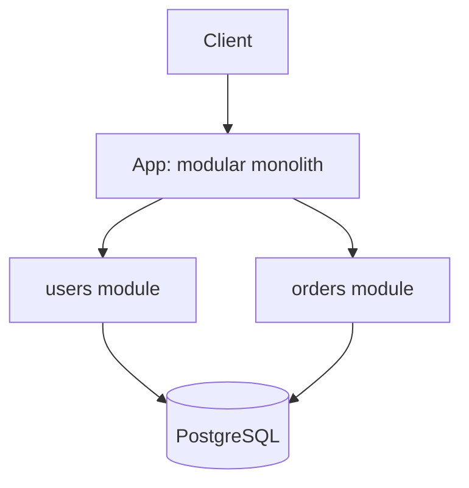

# Architecture Overview Template

Read this when writing or updating `docs/architecture/overview.md` (Steps 5 and 7).

Rules:

- Fill only what applies. Mark optional components (cache, queue, broker, gateway, search) as "Not needed yet" instead of inventing them.
- Write facts and decisions, not textbook material. Link ADRs for the reasoning.
- Brownfield: keep "Current State" above "Target State". Greenfield: delete the Current State and Migration Plan sections.
- Updating an existing file: change only the affected sections and add a Revision History line. Do not replace the whole file without asking.

## Template

```markdown
# Architecture Overview

**Project**: [Name]
**Pattern**: [Monolith / Modular Monolith / Microservices / Serverless]
**Status**: [Proposed / Accepted]
**Last Updated**: [YYYY-MM-DD]

## Problem
[One paragraph: what the backend does and for whom.]

## Requirements and Targets
| Item | Target or assumption |
|------|----------------------|
| Users | [e.g. 5k daily active] |
| Peak load | [requests/sec] |
| Data volume | [size now, growth per month] |
| Latency | [p95 / p99] |
| Availability | [SLO, e.g. 99.9%] |
| RPO / RTO | [e.g. 15 min / 1 h] |
| Tenancy | [single / shared / isolated] |
| Compliance / residency | [e.g. GDPR, region] |
| Budget | [monthly ceiling] |
Assumptions are marked "(assumed)".

## Current State (brownfield only)
- Structure: [modules or services as they exist]
- Data ownership: [who reads and writes which tables]
- Integrations: [external systems]
- Pain points: [problem -> evidence (file, metric, incident)]

## Target State
### Components
| Component | Technology | Purpose | Required? |
|-----------|-----------|---------|-----------|
| App / services | [Tech] | [Purpose] | Yes |
| Primary database | [Tech] | [Purpose] | Yes |
| Cache | [Tech] | [Purpose] | [Yes / Not needed yet] |
| Queue or broker | [Tech] | [Purpose] | [Yes / Not needed yet] |
| Gateway / load balancer | [Tech] | [Purpose] | [Yes / Not needed yet] |

### Tech Stack
- Language / framework: [Choice] (ADR-NNNN)
- Database: [Choice] (ADR-NNNN)
- API protocol: [Choice] (ADR-NNNN)

### Module Boundaries
| Module | Responsibility | Inbound interface | Outbound ports | Owns data | Forbidden dependencies |
|--------|----------------|-------------------|----------------|-----------|------------------------|
| [Module] | [Reason to exist] | [HTTP / queue / cron] | [repo / client / queue] | [tables] | [what it must not call] |

### Data Flow
1. [Client -> app -> module -> database]
2. [Write path that publishes an event, if any]
3. [Hot reads through the cache, async work through the queue, if those exist]

### API Contracts (high level)
- [Resource groups or services and their main endpoints; detail belongs to backend-api-design]

## Engineering Rules
- Handlers stay thin and transport-only.
- Use cases own business workflow and transaction boundaries.
- Repositories are adapters, not business-rule containers.
- Domain logic does not depend on framework or ORM types.
- Cross-module access goes through explicit contracts, never another module's tables.

## Consistency Rules
| Use case | Rule |
|----------|------|
| [e.g. place order] | [single ACID transaction / outbox event / saga with compensation] |
Idempotent operations: [list, with the key used]

## Security Boundaries
- Authentication: [method] (backend-auth)
- Authorization: [RBAC / ownership / tenant-scoped]
- Tenant isolation: [mechanism]
- Audit trail: [which actions]
- Threat model: [link to docs/security/... when backend-security has run]

## Operations
- Error taxonomy: [domain, validation, auth, infrastructure]
- Observability: [structured logs with request/correlation ids, metrics for critical flows and failure rates, tracing for cross-service flows when distributed]
- Health: [liveness / readiness]
- Resilience: [timeouts, retries, circuit breakers] (backend-ops)
- Backup and DR: [RPO/RTO mechanism] (backend-ops)
- Deploy target and release strategy: [e.g. container on PaaS, rolling] (backend-deploy)

## Diagrams
- [Link to the backend-visualize output, e.g. docs/diagrams/architecture.md]

## Migration Plan (brownfield only)
| Phase | Change | Exit criteria | Rollback | Owner skill |
|-------|--------|---------------|----------|-------------|
| 1 | [e.g. enforce module boundary in billing] | [tests green, no cross-module table access] | [revert phase] | backend-refactor |

## Decisions
- ADR-NNNN: [Title] ([Status])

## Open Risks
- [Risk -> mitigation or owner]

## Next Steps
- [ ] Database schema design (backend-db-design)
- [ ] Auth design (backend-auth)
- [ ] API design (backend-api-design)
- [ ] Implementation (backend-implement)

## Revision History
- [YYYY-MM-DD] [What changed] ([ADR-NNNN])
```

## Fallback Diagram

Only when backend-visualize is not available, add a minimal sketch under Diagrams. Draw only the components the design actually has; a modular monolith with one database looks like this:



Each module owns its own tables even when they share one database server.
