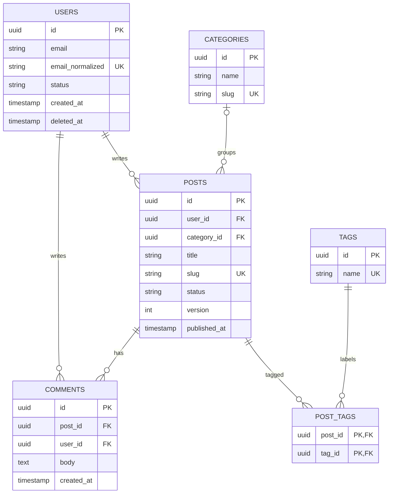

# ERD

Read this in Step 6 when drafting the entity-relationship diagram.

`backend-db-design` owns the content of the ERD (entities, keys, relationships). `backend-visualize` owns rendering conventions (theme, layout, file location, export). Draft the ERD here, then hand it to `backend-visualize` when the user wants a rendered or saved diagram, or when the project already keeps diagrams. If `backend-visualize` is not installed, present the Mermaid source as is.

## Content Rules

- One entity per table or collection, named in UPPER_SNAKE plural to match the table name.
- Mark keys: `PK`, `FK`, `UK` (unique). A column that is both: `FK, UK`.
- Show every relationship in the schema, including ones that are easy to forget (for example `USERS ||--o{ COMMENTS`).
- Cardinality must match the constraints: a nullable FK is `|o--o{`, a `NOT NULL` FK is `||--o{`.
- Junction tables appear as entities with two FKs; do not draw M:N directly.
- List only key and meaningful columns for large tables; the DDL is the full source of truth.
- Types are generic (`uuid`, `string`, `text`, `int`, `decimal`, `timestamp`, `bool`, `json`).

## Template

`email_normalized` is unique only among live rows (partial index); note such conditions in the design summary, since Mermaid cannot show them.
