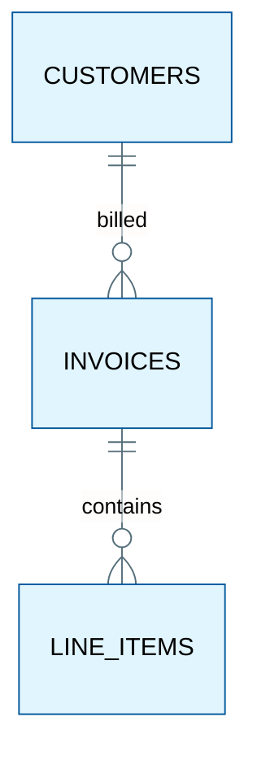

# Backend Visualize

Turns real project sources into Mermaid diagrams that render, read well in light and dark themes, and use one color model across every diagram type.

## When to Use

- The user asks for any diagram of the backend: data model, classes, roles and access, a process, a request flow, a lifecycle, or the system architecture.
- After `backend-db-design`, `backend-architect` or `backend-refactor`, to draw the result.
- Not for designing: schema decisions belong to `backend-db-design`, architecture choices to `backend-architect`. This skill draws what exists or what the user describes.

## Before You Start

1. Resolve the shared docs folder ("<shared>"): first `_shared/` inside this skill's folder (bundled installs, e.g. Claude.ai), then `../_shared/` next to it; other fallbacks are in `<shared>/context-loading.md` -> Resolving `_shared/` Files. A missing shared doc is a warning, not a stop.
2. Read `<shared>/tool-rules.md` (mode=auto contract, checkpoints) and `<shared>/host-tools.md` if the actions named here do not match your host's tool names.
3. Load project memory per `<shared>/context-loading.md`, but only the files the chosen diagram type needs (see the Sources table). If memory is missing or stale and the source is the codebase, suggest `backend-scan` and continue from code.
   - **Skip project and memory checks** when the source is a user description or pasted DDL/models. A quick sketch needs no project root.
4. If the detected stack matches a file in `<shared>/stacks/`, read it (for example ORM and migration layout hints).

## References

Load only what the requested diagram needs.

- `references/theme.md`: read before writing any diagram. Color rule, classDef palette, init directive, dark mode, accessibility metadata, legend rule, renderer versions.
- `references/syntax-rules.md`: read before writing any diagram and when a render fails. Ids, label quoting, semicolons, applying classes per diagram type, `&` fan-out, common errors.
- `references/erd.md`: read when the user wants an ERD or database diagram. Source precedence, cardinality and type mapping, template.
- `references/class-diagram.md`: read when the user wants a class diagram or domain model.
- `references/actor-diagram.md`: read when the user wants a user, role or access diagram.
- `references/flowchart-sequence.md`: read when the user wants a flowchart, a sequence diagram or a state/lifecycle diagram.
- `references/architecture.md`: read when the user wants an architecture, deployment-topology, module-dependency or C4-style context diagram.

## Sources per Diagram Type

| Diagram | Preferred sources (highest first) | Memory files to load |
|---|---|---|
| ERD | migrations or DDL, ORM models, user input, `db-schema.md` | `db-schema.md`, `tech-stack.md` |
| Class | ORM models, domain and service classes | `tech-stack.md` |
| User / Actor | auth config, role definitions, route guards | `project-overview.md`, `api-patterns.md` |
| Flowchart | user description, handler and service code | `project-overview.md` |
| Sequence | routes, controllers, middleware, service calls | `api-patterns.md` |
| State | status enums, state-machine code | `db-schema.md` |
| Architecture / deployment / modules | deployment config, imports, DI wiring | `project-overview.md`, `tech-stack.md`, `deployment.md` if present |

Never invent columns, methods, services or routes. If a source lacks detail (for example `db-schema.md` has no column lists), draw at the level the source supports and say what is omitted.

## Workflow

### Step 1: Pick the diagram type

- If the user named a type ("draw an ERD") or the request implies one ("how does login work" -> sequence), use it. Do not show a menu.
- Otherwise ask once, with this menu:

```text
Which diagram would you like?
1. ERD - tables and relationships
2. Class diagram - domain classes and associations
3. User / actor diagram - who can do what
4. Flowchart - a business process or data flow
5. Sequence diagram - one request or interaction over time
6. State diagram - the lifecycle of one entity
7. Architecture - components, deployment or module dependencies
8. Several - every type that fits the input
```

Output: one or more chosen types.

### Step 2: Find the source

- Default: if the user gave a source (pasted DDL, a file, a description), use it. Otherwise auto-detect from the project using the Sources table: find files (migrations, schema files, models, routes), search file contents, and read the relevant files.
- Ask the user only when nothing usable is found or two sources conflict in a way that changes the diagram.
- If cardinality, optionality or a flow branch is ambiguous, ask before drawing.

Output: the list of files or inputs the diagram is built from.

### Step 3: Load the references

Read `references/theme.md`, `references/syntax-rules.md`, and the reference for each chosen type. Do not load the other templates.

### Step 4: Generate

- Follow the reference template's structure, but use the project's real names. Never copy template names (Blog, Orders, Billing) into the user's diagram.
- Every diagram:
  - starts with the init directive from `theme.md` on line 1, then the diagram header;
  - has `accTitle` and `accDescr`;
  - uses only the palette class names from `theme.md`, chosen by node role, with the matching shape;
  - has no semicolons, unique alphanumeric ids, and quoted labels for anything with special characters;
  - keeps groups to 3-7 nodes; past about 12 nodes, split into groups or separate diagrams.
- For "several" diagrams, use this order and skip types the input cannot support: Architecture, User / Actor, ERD, Class, Flowchart, Sequence, State. Say in one line why each is useful.
- If the project already has diagrams in another style, ask whether to match them; otherwise use this skill's theme.

Output: Mermaid source for each diagram.

### Step 5: Validate

1. Check each diagram against `references/syntax-rules.md` -> Common Errors: init directive on line 1, balanced `subgraph`/`end` and braces, no semicolons, no `&` outside flowcharts, unique ids, quoted special labels, correct class-application form for the diagram type.
2. If `mmdc` (from `@mermaid-js/mermaid-cli`) is on the PATH, render each diagram to check syntax:
   - write the diagram to a temporary `.mmd` file outside the project (the OS temp folder or your scratch folder);
   - run a shell command: `mmdc -i <temp>.mmd -o <temp>.svg`;
   - it starts a headless browser, so allow about 60 seconds per diagram (see `<shared>/tool-rules.md` -> Command Time Budgets);
   - on an error, fix the diagram and render again (at most 3 attempts per diagram), then delete the temp files.
3. If `mmdc` is not installed, do not install it without asking. Installing a package (including `npx -p @mermaid-js/mermaid-cli`, which downloads it) is Always Ask First in `<shared>/tool-rules.md`. Offer it once; if declined, rely on the checklist and say "not render-tested" in Notes.
4. If a render keeps failing, simplify: reduce nodes, remove nesting, drop styling lines the renderer rejects (see `theme.md` -> Renderer Versions).

Done when every diagram passes the checklist and, where `mmdc` is available, renders without errors.

### Step 6: Present

Use this format for each diagram:

````markdown
## ERD - Billing Service

One sentence on what the diagram shows and which sources it was built from.



**Legend:**
- Blue boxes (entity) = tables
- Solid lines = relationships, with cardinality at each end

**Notes:**
- Columns omitted: db-schema.md lists tables only. Ask to read the migrations for a full ERD.
- Validation: rendered with mmdc.
````

- Build the legend from the classes and edge styles the diagram actually uses (`theme.md` -> Legend Rule).
- Notes list assumptions, omitted detail, source conflicts, and whether the diagram was render-tested.

### Step 7: Save (optional)

Ask: "Save these diagrams to a file?" Suggest `docs/diagrams/<topic>.md` (or the project's existing docs folder). Do not offer to write diagrams into project memory; no memory file holds diagrams.

If the user agrees:

1. Check whether the target file exists. If it does, show what would change and ask whether to replace it, append a new section, or pick another name. Never overwrite silently.
2. Start a checkpoint before the first edit: `node <shared>/scripts/checkpoint.js start --skill backend-visualize --feature <slug>`. Record each file you create or edit (`checkpoint.js record`), snapshot after writing, and close it when done. If Node is unavailable, follow `<shared>/tool-rules.md` -> Concurrent & Partial Work by hand.
3. Start the file with a provenance header:

```text
<!-- Generated by backend-visualize on YYYY-MM-DD from: <source files> at commit <short sha or "uncommitted"> -->
```

4. Write each diagram in the Step 6 format.

Done when the diagrams are presented (and, if requested, saved with the checkpoint closed).

## Edge Cases

- **No schema or code**: ask the user to describe the entities or components, then draw from the description and say so in Notes.
- **Very large schema or system**: one diagram per bounded context or service, plus a small overview diagram. Offer the split before drawing everything.
- **Schema unchanged after a refactor**: offer a module-dependency diagram (`architecture.md` -> Variants) instead of an identical ERD.
- **Diagram too wide**: switch `LR` to `TD`, or split into linked diagrams.
- **Renderer rejects valid syntax**: the target renderer is probably older; drop the lines listed in `theme.md` -> Renderer Versions.

## Rules

- Read-only by default. The only writes are the optional saved diagram file and its checkpoint, after the user agrees.
- One color model: color encodes node role, containers encode groups, and every color is paired with a shape or label cue.
- Every fence you open is closed. Use a four-backtick outer fence when an example contains a fenced block.
- Validate before presenting. Never present a diagram you know fails to render.
