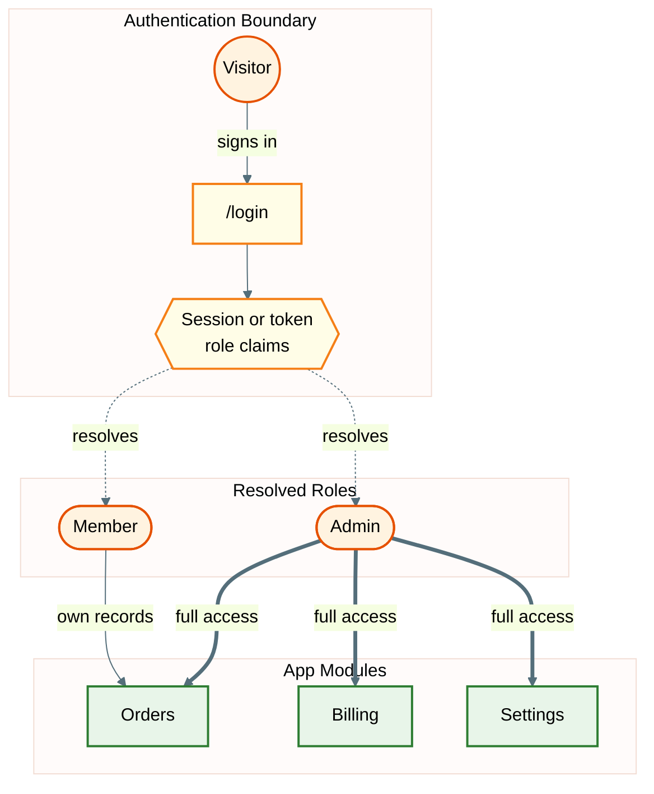

# User / Actor Diagram

Read when the user asks who uses the system, what each role can do, or for an access map. Also read `theme.md` and `syntax-rules.md`.

## Sources

- Auth configuration, role and permission definitions, route guards and middleware.
- `project-overview.md` for modules; `api-patterns.md` for the auth method.
- Take role, module and route names from the project. The template below uses placeholder names only.

## Template

## Actor Diagram Rules

- Direction `graph TD` for layered access maps; `graph LR` only for short linear flows.
- Node shapes carry meaning (and pair with the color class from `theme.md`):
  - `((Label))` external person or visitor (`actor`)
  - `([Label])` resolved role, tenant or identity (`actor`)
  - `["/route"]` entry route or form; always quote routes (`boundary`)
  - `{{Label}}` session, token evaluation or middleware (`boundary`)
  - `[Label]` internal module, page or service (`service`)
  - `[(Label)]` data store (`database`)
- Edge styles: `-->` direct flow, `-.->` evaluation or lookup, `==>` full or privileged access. Label every access edge with its scope.
- Use `&` to fan out one role to many modules, on one line (see `syntax-rules.md` -> Fan-out).
- Typical groups: authentication boundary, resolved roles, app modules, separate surfaces (for example a customer portal or partner API).
- Keep each subgraph to 3-7 nodes. If a role reaches more than 7 modules, collapse the rest into an "Other modules" node or draw a second diagram per role.
- If roles are tenant-scoped, say so on the edge label (`own tenant`) and in Notes.
