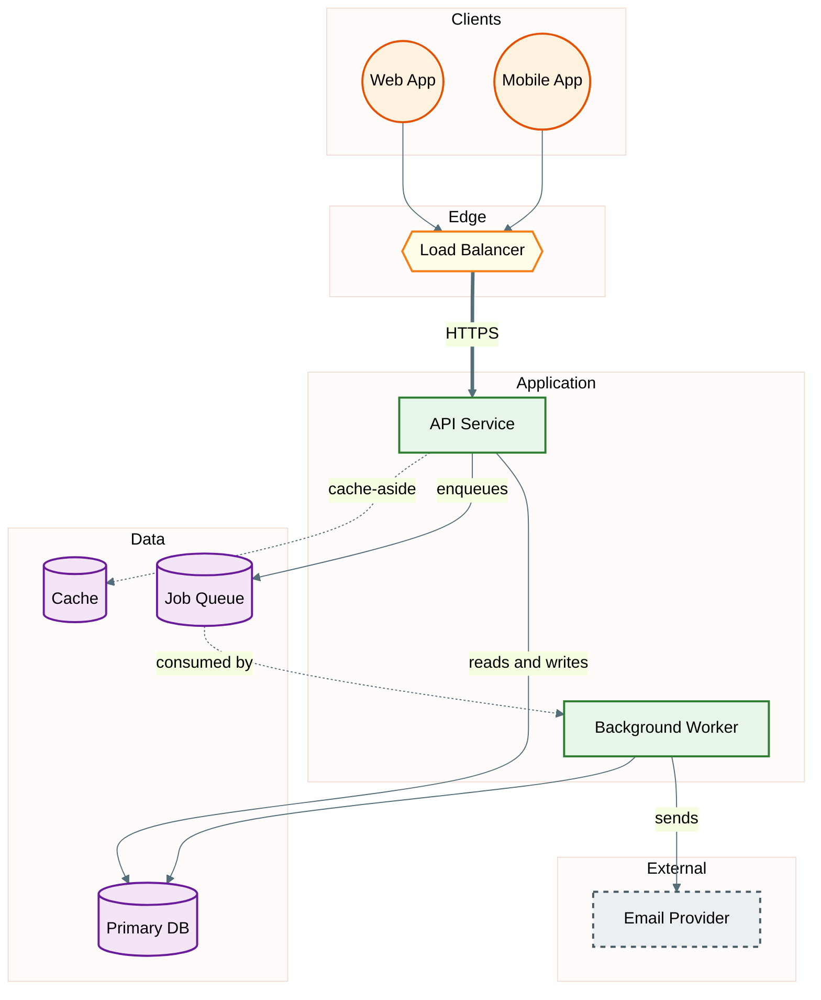

# Architecture Diagram

Read when the user asks for an architecture, system, component, deployment-topology or module-dependency diagram. Also read `theme.md` and `syntax-rules.md`.

## Sources

- `project-overview.md` (structure, module boundaries) and `tech-stack.md` (databases, caches, queues, providers).
- Deployment config when present: Dockerfiles, compose files, Kubernetes manifests or Helm charts, IaC, platform config. Read `deployment.md` in memory if it exists.
- Code for module dependencies: import statements, DI container registrations, module files.
- Draw only components the sources show. A modular monolith is one service box with internal modules, not a set of services. Do not add a gateway, cache, queue or replica unless the project has one.

## Template

## Architecture Rules

- Layers as subgraphs: Clients, Edge, Application, Data, External. Drop a layer the project does not have.
- Layer subgraph ids end in `Layer` so they never collide with node ids.
- `==>` for the main or high-volume path, `-->` for normal calls, `-.->` for async or cache lookups. Label edges whose protocol or purpose is not obvious.
- Third-party components use the `external` class (dashed border).
- Use `&` fan-out on one line when one component calls several (`Api --> DB & Cache & Jobs`).
- Keep each layer to 3-7 nodes. For many services, draw one context diagram (services as single boxes) plus one diagram per service.

## Variants

- **Deployment topology**: same layers, but nodes are runtime units (containers, pods, functions, managed services) and subgraphs are environments, clusters or networks. Show only what the deployment config defines.
- **Module dependencies**: `graph LR`, one node per module or package, an edge from importer to imported module. Build it from real imports or DI registrations. Mark cycles with a thick red edge (`linkStyle N stroke:#c62828,stroke-width:3px`, where N is the zero-based index of the edge) and list them in Notes. Use this view after a refactor, when the schema did not change.
- **C4-style context**: one box for the system, actors around it, external systems with the `external` class. Mermaid's dedicated C4 syntax is still experimental; prefer the flowchart form for portability.
