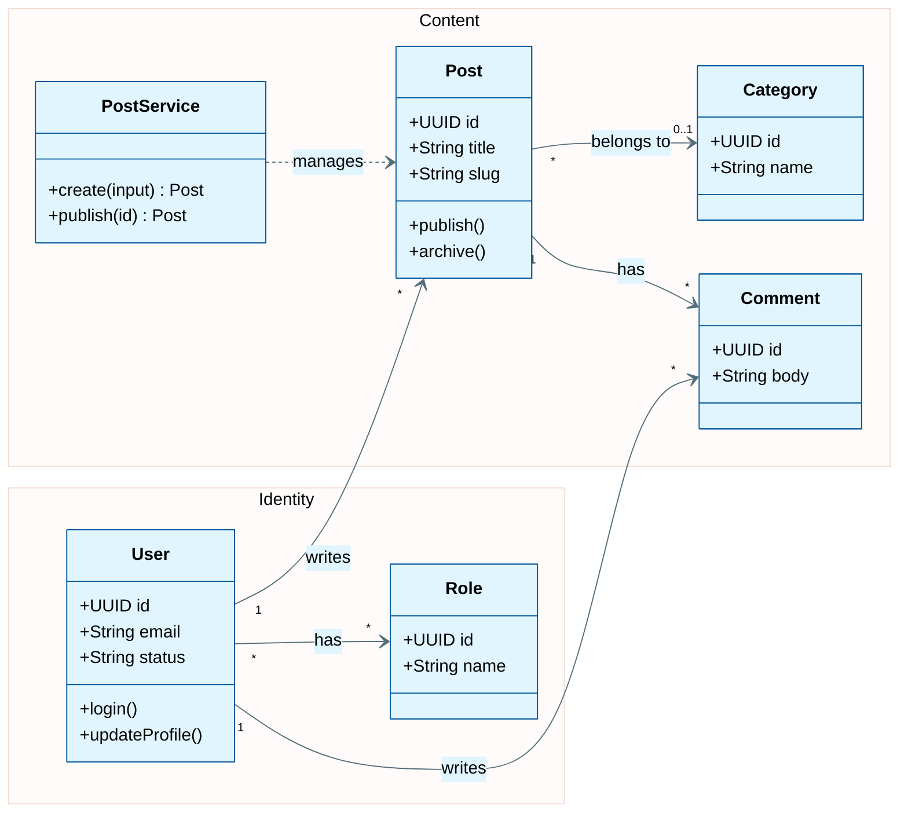

# Class Diagram

Read when the user asks for a class diagram, a domain model or an object/model view. Also read `theme.md` and `syntax-rules.md`.

## Sources

- ORM models and domain entities (classes, structs, records, interfaces).
- Service and repository classes when the user wants behavior, not just data.
- `db-schema.md` only as a fallback; it has no methods and few columns, so draw fields memory names and say the rest are omitted.

Read the actual class files. Do not invent methods. Show only public members unless the user asks for internals.

## Template

## Class Diagram Rules

- Group with `namespace Name { ... }`. Names are plain identifiers (`Identity`, `Content`): no spaces, no emoji.
- Apply colors with `cssClass "A,B" name` or inline `class A:::name`. Never `class A,B name` (that form is for flowcharts).
- No semicolons. No `&` chaining; one association per line.
- Show visibility: `+` public, `-` private, `#` protected, `~` package/internal.
- Label associations with cardinality and a verb: `A "1" --> "*" B : verb`. Use `0..1` for optional ends.
- Relationship arrows: `-->` association, `*--` composition, `o--` aggregation, `<|--` inheritance, `..|>` implements, `..>` dependency.
- Generics use tildes: `List~Post~`.
- In a class diagram a many-to-many is fine at the domain level (`"*" --> "*"`); the junction table belongs in the ERD.
- Keep each namespace to 3-7 classes. Split large models per namespace.
