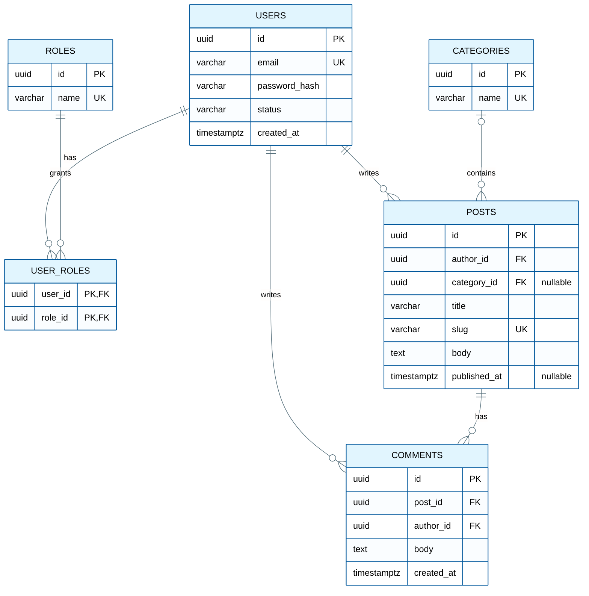

# ERD (Entity-Relationship Diagram)

Read when the user asks for an ERD, a database diagram or "show me the schema". Also read `theme.md` and `syntax-rules.md`.

## Sources and Precedence

Use the most authoritative source available, in this order:

1. Migration files or SQL DDL (what the database actually has).
2. ORM model files (Prisma schema, TypeORM/Sequelize/Drizzle/MikroORM models, SQLAlchemy/Django models, GORM structs, JPA entities, EF Core entities).
3. A pasted schema or plain-text description from the user.
4. `db-schema.md` in project memory.

If sources disagree (for example the ORM has a column that no migration creates), draw from the higher-ranked source and list the mismatch in Notes.

### Memory-only ERDs

`db-schema.md` records tables, purposes and relationships, but not full column lists. When it is the only source:

- Draw a **table-level ERD**: entities and relationships, with only the key columns memory actually names.
- Never invent columns, types or constraints. Say in Notes that columns are omitted and offer to read the ORM or DDL for a full ERD.

## Mapping Rules

### Cardinality

| Schema fact | Mermaid |
|---|---|
| Required FK on the child (`NOT NULL`) | `PARENT \|\|--o{ CHILD : verb` |
| Nullable FK on the child | `PARENT \|o--o{ CHILD : verb` |
| Unique FK (one-to-one), required | `PARENT \|\|--\|\| CHILD : verb` |
| Unique FK (one-to-one), nullable | `PARENT \|\|--o\| CHILD : verb` |
| Many-to-many | Draw the junction table: `A \|\|--o{ A_B : has` and `B \|\|--o{ A_B : has` |

Never draw `}o--o{` between two tables when a junction table exists; draw the junction table. Use `}o--o{` only for a conceptual sketch from a description, and say so in Notes.

If the schema does not settle cardinality or optionality, ask the user before drawing.

### Attribute Types

Mermaid ER attribute types are a single word. Sanitize database types:

| Database type | Write | Put the detail in the comment |
|---|---|---|
| `decimal(10,2)`, `numeric(12,4)` | `decimal` | `decimal amount "10,2"` |
| `varchar(255)`, `character varying` | `varchar` | optional |
| `timestamp with time zone` | `timestamptz` | |
| `enum('a','b')`, Postgres enum type | `enum` or the enum type name | `enum status "draft, published"` |
| `text[]`, `jsonb` | `text_array`, `jsonb` | |

Attribute names follow the same rule: one word, no spaces.

### Keys

- Mark keys after the name: `PK`, `FK`, `UK`. A column that is both is written `PK, FK`.
- Mark `UK` on every column with a unique constraint or unique index.
- Composite keys: mark each member column.

## Template

Note how the template follows the rules: the many-to-many between users and roles is a junction table, the nullable `category_id` uses `|o--o{`, and there is no `classDef` because the init directive colors all entities.

## ERD Rules

- No `subgraph` in `erDiagram`; Mermaid fails to parse it. Group with `%% Context name` comment headers.
- One relationship per line; `&` does not work here.
- Relationship labels are short verbs (`writes`, `has`, `contains`).
- Keep each bounded context to 3-7 entities. If a context has more, draw one ERD per context and a small overview ERD of the contexts' key tables.
- If the project has soft deletes, audit columns or tenancy columns (`deleted_at`, `tenant_id`), show them only on the tables that have them, and mention the pattern in Notes.
