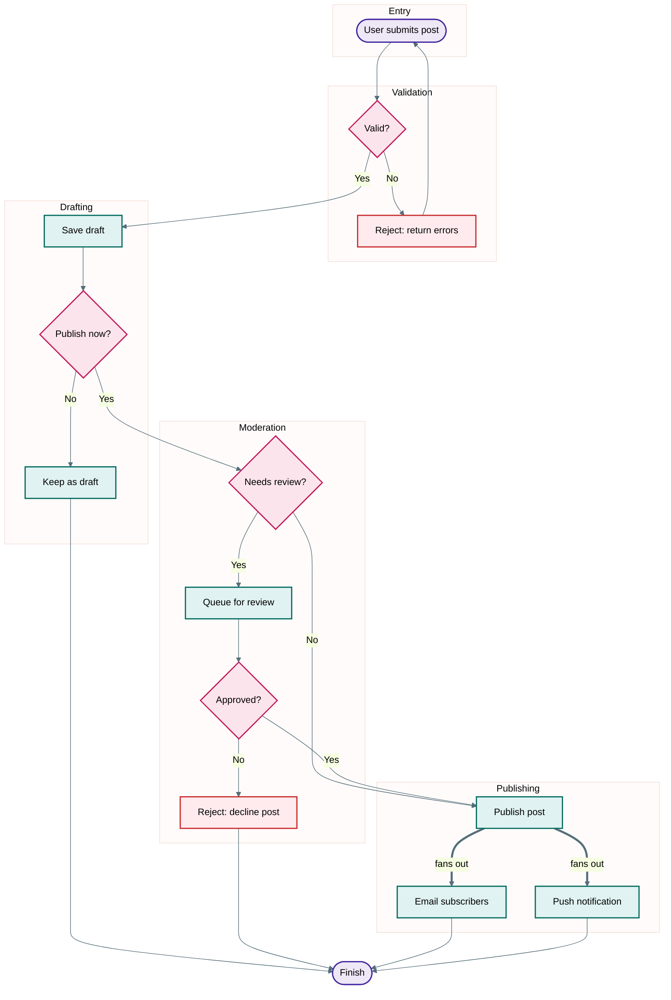
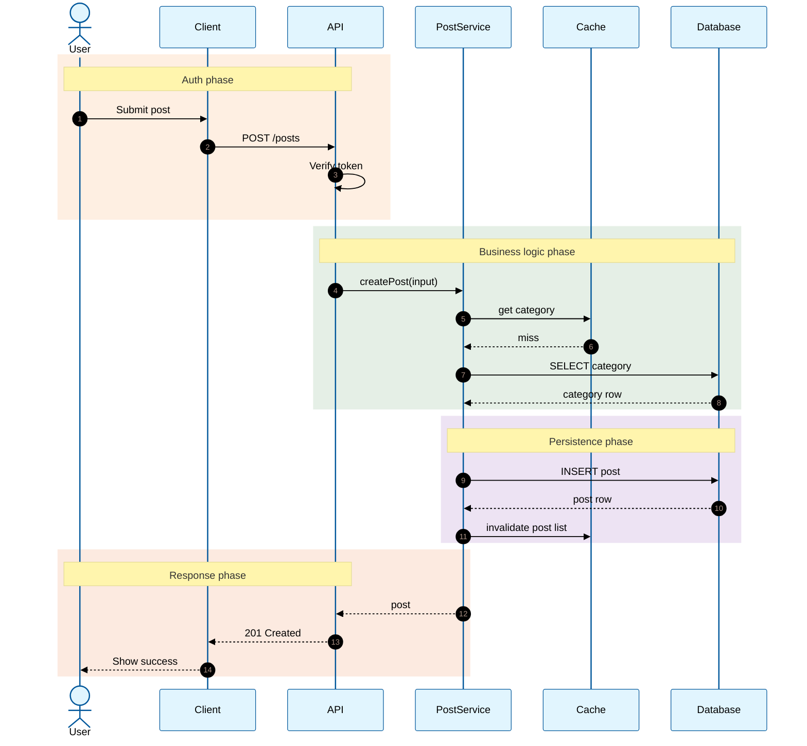
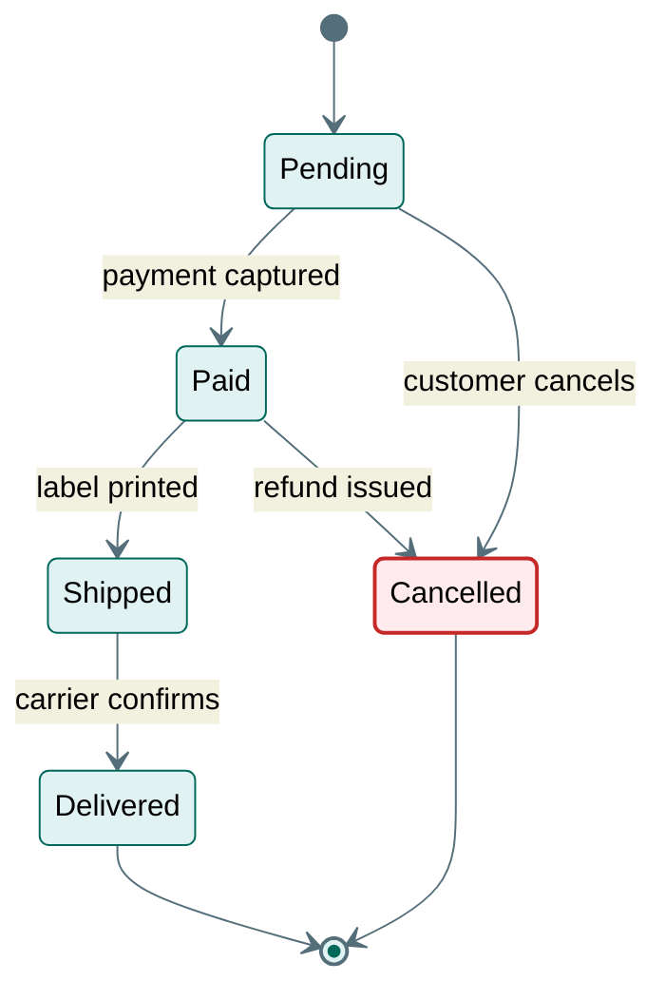

# Flowchart, Sequence and State Diagrams

Read when the user asks for a business process or data flow (flowchart), a request or interaction over time (sequence), or an entity lifecycle such as order or payment status (state). Also read `theme.md` and `syntax-rules.md`.

## Sources

- Flowchart: the user's description, handler and service code, `project-overview.md`.
- Sequence: route and controller files, middleware, service calls, `api-patterns.md`. Trace one request from the route handler through each call it makes.
- State: enum or status columns, state-machine libraries, and the code paths that change the status.

## Flowchart Template

### Flowchart Rules

- Shapes: `([Label])` start or end (`terminal`), `{Label}` decision (`decision`), `[Label]` step (`process`), failure steps get `error` and a "Reject:" or "Error:" label prefix.
- Subgraph ids end in `Phase` (or another suffix) so they never collide with node ids.
- Label every edge leaving a decision: `-->|Yes|`, `-->|No|`, `-->|timeout|`.
- Keep the happy path running top-to-bottom (or left-to-right with `graph LR`).
- Use `&` fan-out on one line for one step that triggers several (`GoLive ==>|fans out| Email & Push`).

## Sequence Template

### Sequence Rules

- `actor` for people, `participant` for systems. Short aliases (`API`, `Svc`, `DB`).
- `autonumber` for numbered steps. `->>` for calls, `-->>` for returns, `A->>A: msg` for self-calls.
- Group phases with `rect rgba(R, G, B, 0.12)` blocks. Pick the RGB from the stroke color of the palette role the phase is about: boundary `245, 127, 23` for auth, service `46, 125, 50` for business logic, database `106, 27, 154` for persistence, actor `230, 81, 0` for the response to the user, error `198, 40, 40` for failure handling. The low alpha keeps text readable in light and dark themes.
- Start each `rect` with `Note over X,Y: Phase name`. A note is not a message and does not advance `autonumber`.
- Show failure paths with `alt` / `else` blocks, and retries with `loop`.
- No `&` and no `classDef` in sequence diagrams.

## State Diagram Template

Use for entity lifecycles (order status, payment status, subscription state).

### State Rules

- State names come from the real enum values. Transition labels name the event or code path that causes them.
- Only draw transitions the code actually allows; list guard conditions in Notes.
- Use `state Name { ... }` for composite states only when the code has sub-states.
