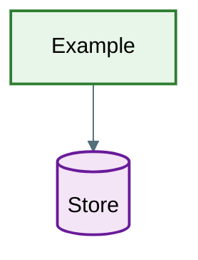

# Theme, Color Rule and Accessibility

Read this before writing any diagram. It defines the one color model every template uses.

## The Color Rule

Color encodes the **role** of a node, never its group. Groups are shown with containers (`subgraph` in flowcharts, `namespace` in class diagrams, `rect` blocks in sequence diagrams). In `erDiagram`, which has no containers, groups are shown with `%%` comment headers and by splitting large schemas into one ERD per bounded context.

Every diagram uses the class names below and no others. Do not invent per-diagram class names such as `auth`, `module` or `portal`.

| Class | Fill | Stroke | Role | Shape cue (always paired with the color) |
|---|---|---|---|---|
| `entity` | `#e1f5fe` | `#01579b` | Tables, entities, domain classes | rectangle `[Label]` |
| `actor` | `#fff3e0` | `#e65100` | People, roles, client apps | circle `((Label))` or stadium `([Label])` |
| `service` | `#e8f5e9` | `#2e7d32` | Services, modules, controllers, pages | rectangle `[Label]` |
| `database` | `#f3e5f5` | `#6a1b9a` | Databases, caches, queues, object stores | cylinder `[(Label)]` |
| `external` | `#eceff1` | `#455a64` (dashed) | Third-party APIs and providers | rectangle with dashed border |
| `boundary` | `#fffde7` | `#f57f17` | Gateways, edges, auth session, middleware | hexagon `{{Label}}` |
| `process` | `#e0f2f1` | `#00695c` | Process steps, use cases | rectangle `[Label]` |
| `decision` | `#fce4ec` | `#c2185b` | Decision points | diamond `{Label}` |
| `terminal` | `#ede7f6` | `#4527a0` | Start and end of a flow | stadium `([Label])` |
| `error` | `#ffebee` | `#c62828` | Failure or rejection paths | rectangle, label starts with "Reject:" or "Error:" |

Color must never be the only cue. Pair every class with its shape, its container label, or a label prefix, so the diagram still reads in grayscale and for color-blind readers.

## classDef Block

Copy only the lines for the classes the diagram actually uses. Write them without trailing semicolons. One rule for all diagram types keeps the parsers happy.

```text
classDef entity fill:#e1f5fe,stroke:#01579b,stroke-width:2px,color:#000
classDef actor fill:#fff3e0,stroke:#e65100,stroke-width:2px,color:#000
classDef service fill:#e8f5e9,stroke:#2e7d32,stroke-width:2px,color:#000
classDef database fill:#f3e5f5,stroke:#6a1b9a,stroke-width:2px,color:#000
classDef external fill:#eceff1,stroke:#455a64,stroke-width:2px,stroke-dasharray:5 5,color:#000
classDef boundary fill:#fffde7,stroke:#f57f17,stroke-width:2px,color:#000
classDef process fill:#e0f2f1,stroke:#00695c,stroke-width:2px,color:#000
classDef decision fill:#fce4ec,stroke:#c2185b,stroke-width:2px,color:#000
classDef terminal fill:#ede7f6,stroke:#4527a0,stroke-width:2px,color:#000
classDef error fill:#ffebee,stroke:#c62828,stroke-width:2px,color:#000
```

This block is fenced as `text` on purpose: it is a fragment, not a diagram. It goes inside a diagram, after the nodes and edges.

How to apply a class differs per diagram type. See `syntax-rules.md` -> Applying Classes.

## Theme Init Directive

Every diagram starts with this directive on the first line, before the diagram header (`graph TD`, `erDiagram`, and so on). It is a Mermaid directive: `%%{init: ...}%%` with a JSON object (double-quoted keys and strings).



Why `base`: it is the only Mermaid theme whose colors can be overridden with `themeVariables`. Pinning it also stops a dark host theme from recoloring nodes.

For `stateDiagram-v2`, set `primaryColor` and `primaryBorderColor` to the `process` fill and stroke (`#e0f2f1`, `#00695c`), because states are process steps (see `flowchart-sequence.md`). Every other key stays the same.

For `erDiagram` the directive is the whole styling: `primaryColor` and `primaryBorderColor` paint every entity in the `entity` color, so ERDs need no `classDef` lines (see `erd.md`).

Newer Mermaid releases also accept a YAML front-matter `config:` block. Use the init directive unless the project already uses front-matter config; do not mix both in one diagram.

## Dark Mode

- Node fills above are opaque light colors with black text (`color:#000`), so node text stays readable on dark pages.
- `lineColor` `#546e7a` is a mid gray that is visible on both white and near-black backgrounds.
- Sequence diagram `rect` blocks use `rgba(...)` with low alpha (see `flowchart-sequence.md`), so they tint rather than wash out on dark backgrounds.

## Accessibility Metadata

Add `accTitle` and `accDescr` right after the diagram header in every diagram type that supports them (flowchart/graph, sequence, class, ER, state):

```text
graph TD
    accTitle: Order checkout flow
    accDescr: Shows validation, payment and fulfilment steps from cart submission to order confirmation.
```

Keep `accDescr` to one or two sentences that state what the diagram shows.

## Legend Rule

Build the legend from the `classDef` names the diagram actually uses, in this form:

```text
- Green rectangles (service) = services and modules
- Purple cylinders (database) = data stores
- Dashed gray boxes (external) = third-party providers
```

Do not list classes, shapes or edge styles that are not in the diagram. Add one line per edge style used (solid = direct call, dotted = lookup or evaluation, thick = privileged or high-volume path).

## Renderer Versions

- Use the current stable Mermaid release where you control the renderer.
- `classDef` and `class` inside `erDiagram` are a recent addition (Mermaid 11). `accTitle`/`accDescr` are older but still missing from some renderers. Some hosted renderers (wikis, older Git hosting, IDE previews) lag behind. If the target renderer rejects a line, remove the styling or accessibility lines; the diagram stays valid without them.
- Ask the user where the diagram will be rendered when it matters (GitHub, GitLab, Confluence, an IDE preview), and test with `mmdc` when available (see SKILL.md -> Step 5).
